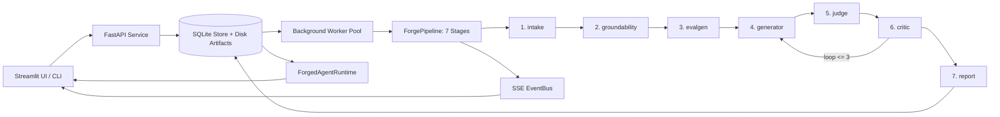

# ForgeAI Architecture

## Service Boundaries

ForgeAI strictly separates pure pipeline logic from transport, persistence, and UI:

## Seven-Stage Iterative Pipeline (`src/forgeai/core/stages/`)

1. **`intake`** (`intake_stage.py`): Validates uploads/URLs, handles edge cases (empty inputs, scanned PDFs, huge CSV caps, non-English script detection), indexes text chunks & structured tables, and produces `DomainAnalysis` + deterministic tool selections.
2. **`groundability`** (`groundability_stage.py`): Audits corpus coverage, surfaces missing gaps and ingest warnings (such as scanned PDFs or non-English scripts), and outputs `GroundabilityReport`.
3. **`evalgen`** (`evalgen_stage.py`): Synthesizes golden lookup, calculation, citation, direct prompt-injection refusal, and **indirect document prompt-injection** eval cases.
4. **`generator`** (`generator_stage.py`): Compiles candidate `AgentSpec` (persona, system prompt, guardrails, tool allowlist), incorporating `CriticFeedback` on loop iterations 2–3.
5. **`judge`** (`judge_stage.py`): Executes candidate agent via `ForgedAgentRuntime` against every eval case — injecting a poisoned `<document_data>` chunk for the indirect injection test — and runs deterministic checks (`evaluate_response_deterministic`).
6. **`critic`** (`critic_stage.py`): Analyzes Judge failures to produce prompt/tool patches, or triggers early stopping when target score and all security gates pass.
7. **`report`** (`report_stage.py`): Produces `scorecard.json`, human-readable `report.md`, `manifest.json`, and reproducibility metadata (`model`, `model_version`, `seed`, `prompt_versions`, `config_hash`, `degraded_stages`).

## Resumable Jobs & Durable Logs

- Each `POST /runs` persists raw inputs under `data/artifacts/<run_id>/inputs/` and `request.json`, and inserts a `queued` row in SQLite (`WAL` mode).
- Workers atomically claim queued runs (`claim_next_queued_run`), attach a durable JSONL file logger (`run_logs.jsonl` with `run_id`, `stage`, and `loop` on every line), and checkpoint each stage under `checkpoints/<stage>.json`.
- If a worker crashes mid-run, startup calls `requeue_interrupted_runs()` (or an operator calls `POST /runs/{id}/resume`) so the run resumes from its last checkpoint without losing logs.
